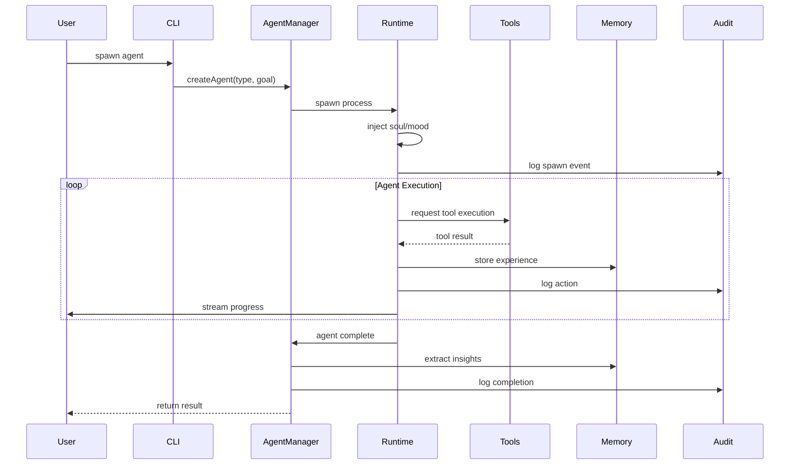
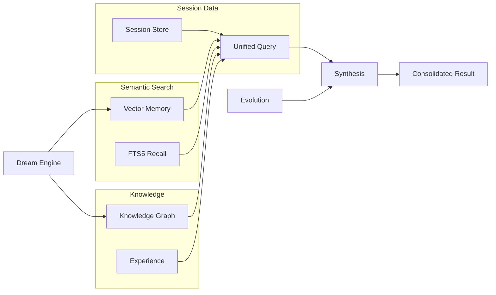
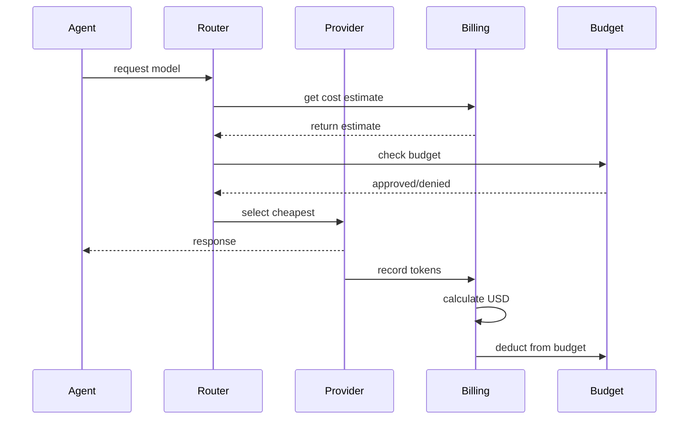
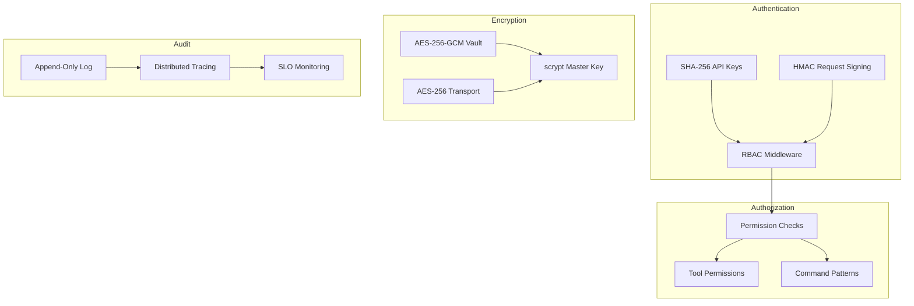
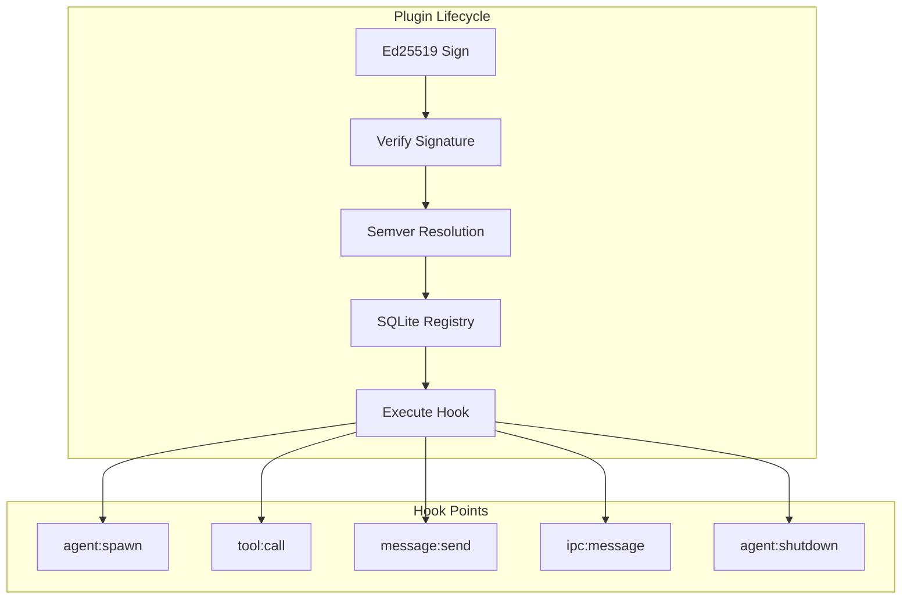
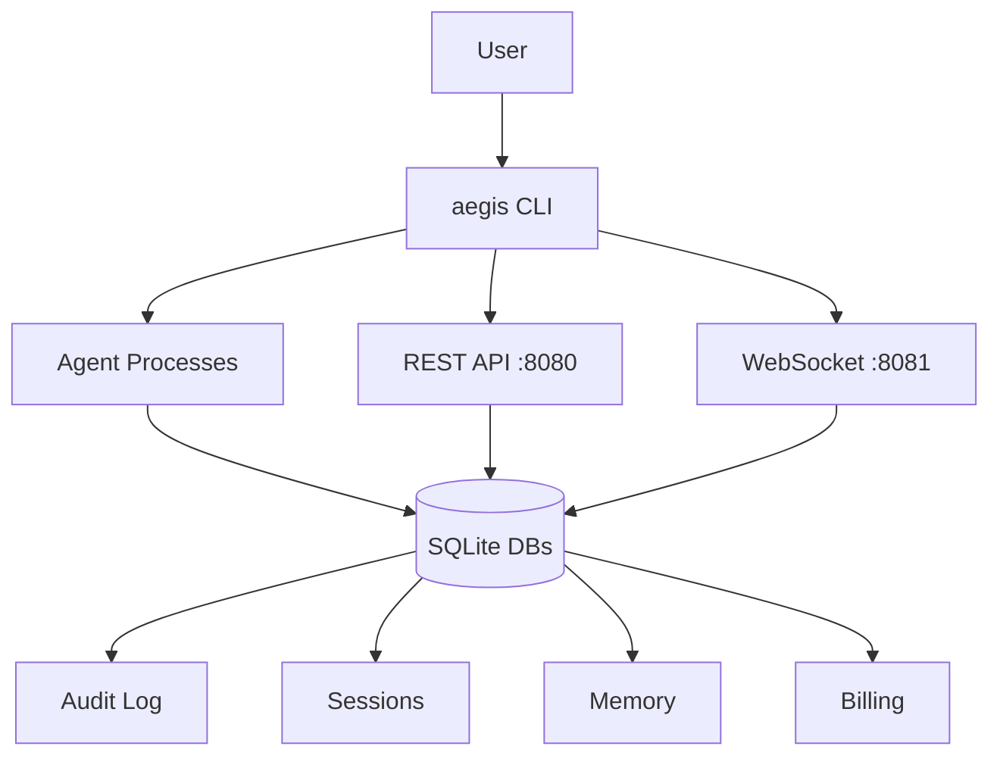
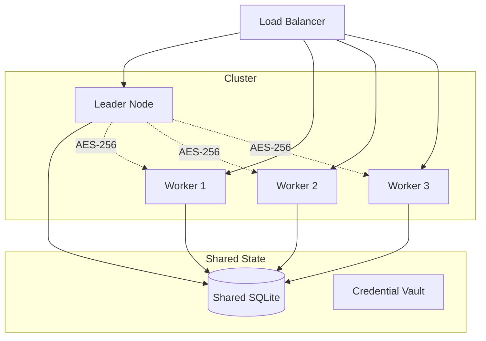
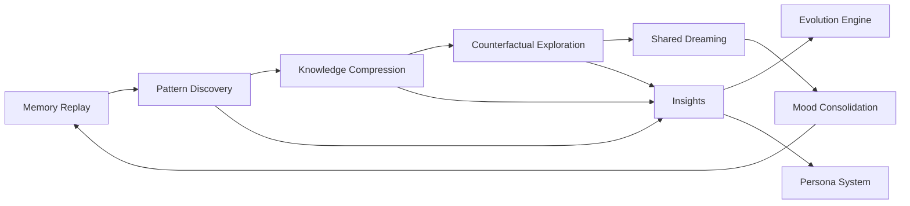
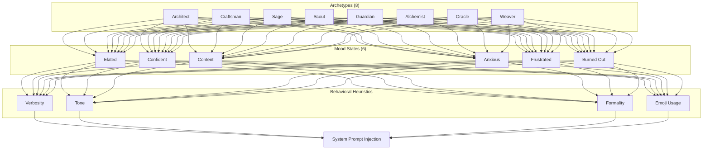

# Neuron OS Architecture

> Detailed system architecture and component diagrams for Neuron OS.

## System Architecture Overview

```mermaid
graph TB
    subgraph "User Layer"
        CLI[CLI / index.ts] --> ML[Mode Launcher]
        WEB[Web Dashboard :5173]
        WS[WebSocket Gateway :8081]
        GW[Multi-Platform Gateway]
    end

    subgraph "Terminal Modes (36+)"
        ML --> CHAT[chat] & DASH[dashboard] & ST[status]
        ML --> MEM[memory] & AGT[agent] & CFG[config]
        ML --> CR[cron] & SK[skills] & SV[serve]
        ML --> CP[mcp] & COST[cost] & RTR[router]
        ML --> EST[estimate] & INS[insights] & BNCH[bench]
        ML --> IMP[improve] & PROD[production] & DIST[distributed]
        ML --> PLG[plugin] & DRM[dream] & EVO[evolve]
        ML --> PER[persona] & SOC[social] & EVAL[eval]
        ML --> MESH[mesh] & TR[train] & TS[toolset]
        ML --> PRJ[project] & VC[voice] & SL[soul]
    end

    subgraph "Agent Runtime"
        AM[AgentManager] --> RT[Runtime]
        RT --> TYPES[14 Agent Types]
        RT --> SOUL{Soul Engine}
        SOUL --> ARCH[8 Archetypes]
        SOUL --> MOOD[6 Mood States]
        AM --> HOOKS[Plugin Hooks: 5 Points]
        AM --> IPC[Typed IPC Protocol]
    end

    subgraph "Consciousness Layer"
        DREAM[Dream Engine] --> PHASES[Replay · Pattern · Compress<br/>Counterfactual · Share · Mood]
        EVOLVE[Evolution Engine] --> MUTATE[Refactor · Optimize · Bugfix<br/>Error-handling · Security · more]
        PERSONA[Persona System] --> TRAITS[Curiosity · Tenacity · Caution<br/>Creativity · Precision · more]
        SOCIAL[Social Network] --> GOSSIP[Peer Discovery · Gossip<br/>Reputation · Trust Levels]
    end

    subgraph "Memory & Knowledge"
        MS[Memory System]
        MS --> KG[(Knowledge Graph)]
        MS --> VEC[(Vector Memory)]
        MS --> FTS5[(FTS5 Recall)]
        MS --> SESS[(Session Store)]
        MS --> EXP[Experience Replay]
    end

    subgraph "Coordination"
        MESH_ENG[Mesh Orchestrator]
        DEBATE[Debate Engine]
        MESH_ENG --> TOPOS[5 Topologies]
        DEBATE --> ARB[3 Arbitrator Types]
    end

    subgraph "Evaluation & Training"
        HARNESS[Eval Harness]
        GRADER[Grader Suite · Golden Dataset]
        CI[CI Gate · Baselines]
        TRAIN[Trajectory Recorder]
    end

    subgraph "Infrastructure"
        PLUGIN[Plugin System]
        PLUGIN --> SIGN[Ed25519 Signed]
        PLUGIN --> REG[SQLite Registry]
        PLUGIN --> SEMVER[Semver Resolution]
        DIST_RT[Distributed Runtime]
        DIST_RT --> POOL[Multi-Host Pool]
        DIST_RT --> ENC[AES-256 Transport]
        API[HMAC-signed REST API]
        AUTH[RBAC · Vault · Audit]
        OBS[SLO · Tracing · Prod Dashboard]
        BILL[Cost Attribution]
        PROJ[Project Workspaces]
        TLS[Toolset System · 10 Bundles]
    end

    subgraph "AI Providers (13)"
        P_ANTH[Anthropic] & P_OAI[OpenAI] & P_DS[DeepSeek]
        P_GK[Groq] & P_GM[Gemini] & P_MS[Mistral]
        P_AZ[Azure] & P_TG[Together] & P_OR[OpenRouter]
        P_XAI[xAI] & P_CH[Cohere] & P_PP[Perplexity] & P_OL[Ollama]
    end

    subgraph "Platform Adapters (11)"
        A_DC[Discord] & A_SL[Slack] & A_TG[Telegram]
        A_SMS[SMS] & A_VC[Voice] & A_WA[WhatsApp]
        A_EM[Email] & A_WH[Webhook]
        A_MX[Matrix] & A_SG[Signal] & A_IR[IRC]
    end

    AM --> MS & PLUGIN & DIST_RT & AUTH & BILL
    DREAM --> MS & SOUL
    EVOLVE --> DREAM
    PERSONA --> DREAM
    SOCIAL --> EVOLVE
    MESH_ENG --> AM
    DEBATE --> MESH_ENG
    HARNESS --> MESH_ENG
    TRAIN --> AM
    API --> AUTH
    GW --> A_DC & A_SL & A_TG & A_SMS & A_VC & A_WA & A_EM & A_WH & A_MX & A_SG & A_IR
    WS --> WEB
    RTR[Model Router] --> P_ANTH & P_OAI & P_DS & P_GK & P_GM & P_MS & P_AZ & P_TG & P_OR & P_XAI & P_CH & P_PP & P_OL
```

## Module Breakdown

| Module | Path | Responsibility |
|--------|------|----------------|
| CLI | `src/cli/` | Command registration, banner, theme, palette |
| Modes | `src/modes/` | Mode framework + 36 TUI mode screens |
| Agent | `src/agent/` | Agent lifecycle, process management, IPC, hooks, soul |
| Soul | `src/agent/soul.ts` | 8 archetypes, 6 moods, behavioral heuristics |
| Dashboard TUI | `src/tui/` | Dashboard rendering, state management, commands |
| Chat TUI | `src/chat/` | Chat UI, streaming, provider integration, sessions |
| Web Dashboard | `dashboard/` | Vite + React 19 frontend with 12 route pages |
| Wizard | `src/wizard/` | Interactive setup flows |
| Tools | `src/tools/` | Tool registry and 8 built-in tool implementations |
| Toolsets | `src/toolsets/` | Composable tool bundles with dependency resolution |
| Skills | `src/skills/` | Skill loading, registry, and remote API client |
| Memory | `src/memory/` | Session persistence, knowledge graph, vector, namespaces, synthesis |
| Experience | `src/experience/` | Experience replay buffer, retrieval, skill curation |
| Dream | `src/dream/` | 6-phase idle-time dream cycle with insight generation |
| Evolve | `src/evolve/` | Auto-code mutation, typecheck+tests verification |
| Persona | `src/persona/` | 8-trait agent personality evolution from experience |
| Social | `src/social/` | Multi-instance gossip protocol, peer discovery, reputation |
| Economy | `src/economy/` | Cost routing, pricing registry, budget guard, pre-flight |
| Improve | `src/improve/` | Skill extraction, failure clustering, adversarial self-play |
| Plugin | `src/plugin/` | Ed25519-signed plugins, SQLite registry, hooks, resolver |
| Mesh | `src/mesh/` | Multi-agent orchestration: 5 topologies, 7 agent roles |
| Debate | `src/debate/` | Disagreement detection, 3 arbitrator types, signed decisions |
| Harness | `src/harness/` | Eval suite: graders, golden dataset, CI gate, experiments, HITL |
| Training | `src/training/` | Trajectory recording and export for every agent session |
| Distributed | `src/distributed/` | Worker pool, encrypted transport, capacity placement, management |
| Adapters | `src/adapters/` | 11-platform gateway (Discord, Slack, Telegram, Matrix, Signal, IRC, etc.) |
| API | `src/api/` | HTTP REST API server with HMAC + RBAC authentication |
| AI | `src/ai/` | Provider manager (13 providers), factory, model references |
| Auth | `src/auth/` | RBAC role management, API key auth, HTTP middleware |
| Vault | `src/vault/` | AES-256-GCM credential vault, env loader, provider bridge |
| Project | `src/project/` | Isolated workspaces with per-project config and state |
| Voice | `src/voice/` | Voice system configuration and provider integration |
| Observability | `src/observability/` | SLO tracking, distributed tracing, production dashboard |
| Triggers | `src/triggers/` | Cron, file_watch, webhook, condition, background agents |
| Audit | `src/audit/` | Append-only audit logging for all agent actions |
| Billing | `src/billing/` | Per-LLM-call cost tracking, budget enforcement |

## Data Flow Architecture

### Agent Lifecycle

### Memory System Flow

### Cost Attribution Flow

## Security Architecture

## Plugin Architecture

## Deployment Architecture

### Single-Node Deployment

### Multi-Node Deployment

## Consciousness Layer Architecture

### Dream Engine Cycle

### Soul Engine

---

## See Also

- [README.md](README.md) — Quick start and system overview
- [ROADMAP.md](ROADMAP.md) — Strategic roadmap
- [docs/](docs/) — Complete documentation